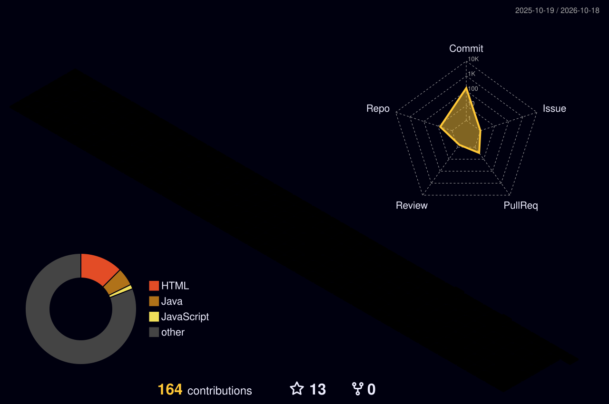

<!-- PROFILE README: Jamilly Santos -->

01 // About Me
> Initializing profile...
> Identity: Developer & Researcher
> Interests: Data Engineering | Cybersecurity
> Mission: Build. Secure. Optimize.
> Status: Always learning.

Welcome to my digital sanctuary.

I am a developer and researcher passionate about systems architecture, data engineering, and cybersecurity. I enjoy exploring complex technologies, designing reliable infrastructures, and transforming information into meaningful solutions.

My philosophy: Bridging the gap between raw intelligence and ironclad security.

02 // Current Endeavors
📚 Currently studying: Advanced Database Management & Optimization
☕ Java: Object-oriented programming and application architecture
🛡️ Cybersecurity: Ethical hacking, vulnerability analysis, and network defense
📊 Data Engineering: Data pipelines, processing, and scalable architectures
🎯 Goal: Build secure, efficient, and scalable technological solutions
03 // Tech Stack

04 // Areas of Expertise

<table width="100%">
<tr>
<td width="50%" valign="top">
<h3>📊 Data Engineering</h3>
<ul>
<li>Data processing & ETL pipelines</li>
<li>Big data architectures</li>
<li>Scalable system design</li>
</ul>
</td>
<td width="50%" valign="top">
<h3>🛡️ Cybersecurity</h3>
<ul>
<li>Vulnerability analysis</li>
<li>Ethical hacking</li>
<li>Network defense & hardening</li>
</ul>
</td>
</tr>
<tr>
<td width="50%" valign="top">
<h3>🗄️ Database Administration</h3>
<ul>
<li>Query optimization</li>
<li>Backup & recovery</li>
<li>Security & access control</li>
</ul>
</td>
<td width="50%" valign="top">
<h3>☕ Software Development</h3>
<ul>
<li>Java & OOP</li>
<li>Application architecture</li>
<li>Clean and maintainable code</li>
</ul>
</td>
</tr>
</table>

05 // GitHub Statistics

06 // 3D Contribution Universe

<i>Every contribution is a step toward mastery.</i>

07 // Contribution Snake

<i>“In the silence of code, logic creates order.”</i>
  
© 2026 Jamilly Santos · Designed with elegance, logic, and precision.

